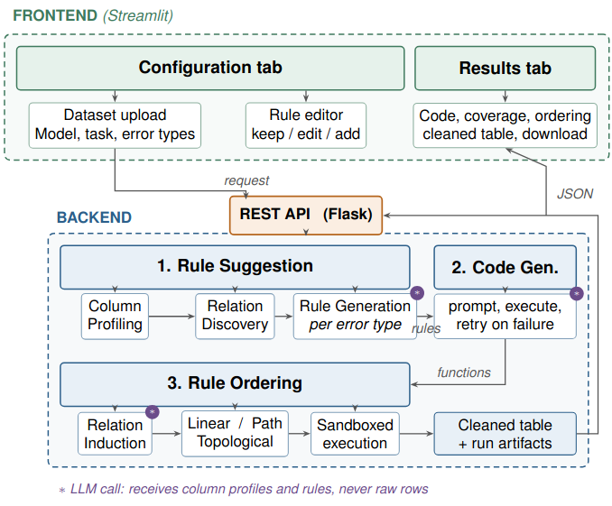

# ReaRClean

**ReaRClean** is an interactive, LLM-assisted data cleaning tool that combines domain expertise with automated rule suggestion, natural language rule-to-code generation, and dependency-aware execution. It is designed for structured data cleaning in settings where statistical signals are unreliable and cross-column constraints are essential.

Unlike traditional cleaning pipelines that rely either on column-wise statistical patterns or fully manual rule engineering, ReaRClean integrates Large Language Models to assist users in discovering, specifying, and operationalizing cleaning logic. The system keeps the domain expert in the loop while automating repetitive and error-prone parts of the workflow.

---

## ✨ Features

- 🧠 **Rule Suggestion**  
  Profiles every column and discovers groups of related columns, then runs one prompt per error type: formatting inconsistencies, missing values, typos, outliers, value spillover and derived values. Each suggestion names the columns it applies to.

- 🧑‍💻 **Expert in the Loop**  
  Every suggested rule arrives as an editable field tagged with the error type that produced it, to keep, edit, add or discard. Rule sets export and re-import as JSON, so a run can be reproduced without paying for suggestion again.

- ⚙️ **Natural Language to Code Generation**  
  Converts cleaning rules expressed in natural language into executable Python functions, through a retry loop that regenerates until the function runs. The generated code stays visible, and compilation cost is paid once rather than per row.

- 🔄 **Dependency-Aware Rule Ordering**  
  Models inter-column dependencies induced by cleaning functions using a graph-based formulation and offers three execution strategies, Linear, Path and Topological, so rules that write values run before the rules that read them.

- 🧹 **Three Cleaning Tasks**  
  Detect flags candidate cells, Impute fills cells that are already empty, and Correct repairs values in place. Chain them by feeding one run's output into the next.

- 🔌 **Any OpenAI-Protocol Endpoint**  
  Hosted and locally served models are interchangeable, and the model only ever sees column profiles and rules, never raw rows.

---

## 🏗️ Framework Overview



ReaRClean is split in two: a Python service holding all the cleaning logic, and a Streamlit frontend that talks to it over a REST API.

---

## 🚀 How to Use / Install

```bash
pip install -r requirements.txt
cp .env.sample .env                # then put your key in it
python backend/service.py          # terminal 1, http://127.0.0.1:8000
streamlit run frontend/app.py      # terminal 2, http://localhost:8501
```

Run both from the repository root. Nothing in the repository contains a credential: the token is read from `OPENAI_API_KEY` and sent with each request rather than stored. Every other setting has a working default; see `.env.sample`.

`data/demos/` holds the running example from the paper, as a dirty table and its clean counterpart.

---

## 🎬 Demo Video

[](https://youtu.be/ZiprUaBFCgs)

---

## 📖 Documentation

[`docs/architecture.md`](docs/architecture.md) covers the modules, the REST API, the error types, the execution sandbox and the full list of configuration variables.