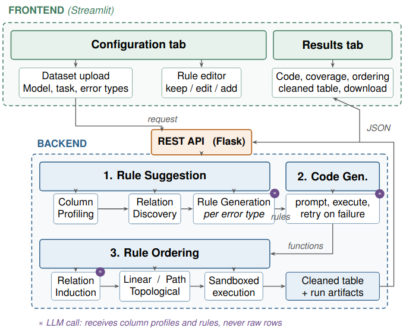

# Architecture

The system is split in two, matching the architecture in the paper: a Python
service holding all the cleaning logic, and a Streamlit frontend that talks to
it over a REST API.

## Backend

One module per box in the architecture figure:

| Module | Architecture component |
|---|---|
| `backend/profiling.py` | Column Profiling |
| `backend/discovery.py` | Relation Discovery |
| `backend/generation.py` | Rule Generation, one prompt per error type |
| `backend/codegen.py` | Code Generation, including the import restriction |
| `backend/ordering.py` | Relation Induction, Linear / Path / Topological |
| `backend/paths.py` | path selection, used only by the Path strategy |
| `backend/execution.py` | sandboxed execution |
| `backend/llm.py` | the single place the model is called |
| `backend/service.py` | REST API |

### Endpoints

| Endpoint | Does |
|---|---|
| `GET /health` | liveness |
| `GET /capabilities` | tasks, orderings, error types, allowed imports |
| `POST /profile` | column profiles only, no model call |
| `POST /suggest` | profiling, relation discovery, rule generation |
| `POST /generate` | one Python function per rule |
| `POST /run` | relation induction, ordering, execution |

A client can enter the pipeline at any stage: post a table and get rules, post
rules and get functions, or post functions and get a cleaned table.

### Error types

Rule suggestion runs one prompt per error type. Adding a type is a change to
`ERROR_TYPES` in `backend/generation.py` alone; the frontend builds its
controls from `/capabilities`, so it needs no edit.

| Code | Type | Scope |
|---|---|---|
| FI | Formatting inconsistency | single-column |
| MV | Missing values | single-column |
| TP | Typos | single-column |
| OT | Outliers | single-column |
| SP | Value spillover | cross-column |
| DV | Derived value | cross-column |

Single-column types receive the full profiles in one call. Cross-column types
receive one group of related columns at a time, with coarse profile
information only.

### Safety

Generated code is executed, so `codegen.check_imports` rejects any function
that imports outside `ALLOWED_IMPORTS`, or that calls `eval`, `exec`, `open`,
`__import__`, `getattr`, `setattr` or a pandas reader such as `read_csv`,
before it is ever run. Compilation and execution then both happen inside a
separate process under a wall-clock timeout, through
`execution.run_code_with_timeout`. A function that fails is reported and the
rest still run.

The backend binds to loopback by default for the same reason. Set
`REARCLEAN_HOST=0.0.0.0` only on a network you trust.

## Frontend

A Streamlit app with two tabs. It holds no cleaning logic; everything goes
through `frontend/client.py`.

- **Configuration**: upload, model settings, task, error types, rule editor,
  ordering choice. Rule sets can be exported and re-imported as JSON, so a run
  can be reproduced without paying for suggestion again.
- **Results**: generated code, rule coverage heatmap, execution order, the
  resulting table with affected cells highlighted, and downloads of both the
  cleaned table and the list of flagged cells.

## Tasks

- **Detect**: rules only read; flagged cells are blanked. Order-invariant, so
  ordering is forced to Linear.
- **Impute**: rules write only into cells that are already empty.
- **Correct**: rules repair values in place.

Chain them by downloading the output of one run and uploading it to the next.

## Configuration

Every setting has a working default; `.env.sample` lists them all.

| Variable | Default | Does |
|---|---|---|
| `OPENAI_API_KEY` | *(none)* | token, prefilled into the frontend field |
| `REARCLEAN_MODEL` | `gpt-4o-mini` | model name |
| `REARCLEAN_ENDPOINT` | `https://api.openai.com/v1/` | OpenAI-protocol endpoint |
| `REARCLEAN_HOST` | `127.0.0.1` | backend bind address |
| `REARCLEAN_PORT` | `8000` | backend port |
| `REARCLEAN_BACKEND` | built from host and port | backend URL the frontend calls |
| `REARCLEAN_MAX_UPLOAD_MB` | `256` | request size cap |
| `REARCLEAN_REQUEST_TIMEOUT` | `1800` | seconds the frontend waits on a request |
| `REARCLEAN_MAX_TOKENS` | `4096` | cap per model response |
| `REARCLEAN_LLM_TIMEOUT` | `60` | seconds per model call |
| `REARCLEAN_LLM_RETRIES` | `2` | retries on a transient model error |
| `REARCLEAN_TRIES` | `10` | regenerations before a function is abandoned |
| `REARCLEAN_FUNC_TIMEOUT` | `60` | wall-clock cap on a generated function |
| `REARCLEAN_EXACT_SEARCH_LIMIT` | `20` | candidate paths above which Path falls back to greedy selection |

Both entry points load `.env` if it is present, and each process puts its own
directory on the import path, which is why the backend modules import each
other by plain name.

## Data

`data/demos/` holds the running example from the paper, as a dirty table and
its clean counterpart. The benchmark tables used in the evaluation are
redistributed by the authors of
[Raha](https://github.com/BigDaMa/raha) and
[ED2](https://github.com/BigDaMa/ExampleDrivenErrorDetection) and should be
taken from there. The maintenance dataset used in the scalability run belongs
to an industrial partner and is not public.